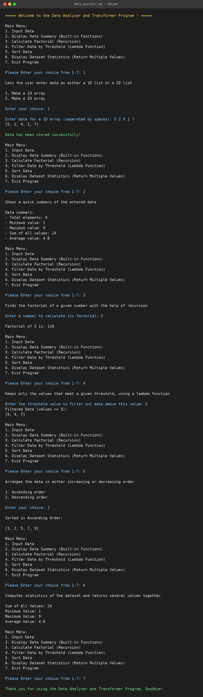

# 📊 Data Analyzer and Transformer Program

## 📝 Project Description

The **Data Analyzer and Transformer Program** is a menu-driven, command-line application written in Python. It lets the user enter numeric data as either a 1D list or a 2D list (matrix), and then analyze and transform that data through a simple text menu.

The project was built to practice core Python concepts such as functions, recursion, lambda functions, built-in functions, `*args` / `**kwargs`, returning multiple values, and docstrings.

## ✨ Features

- 📥 **Input Data**: store data as a 1D array (space-separated values) or a 2D array (rows x columns).
- 📈 **Data Summary**: shows total elements, minimum, maximum, sum, and average using built-in functions (`len`, `min`, `max`, `sum`, `round`).
- ❗ **Factorial Calculator**: calculates the factorial of a number using recursion.
- 🔍 **Threshold Filter**: keeps only the values greater than or equal to a given threshold using `filter()` and a lambda function.
- 🔃 **Sort Data**: sorts the data in ascending or descending order.
- 🧮 **Dataset Statistics**: computes sum, minimum, maximum, and average, returns them together as multiple values, and prints them using `**kwargs`.
- 🔄 **2D to 1D Flattening**: 2D data is automatically flattened so every feature works on both 1D and 2D input.
- 📖 **Docstrings**: each feature shows its description before running.
- 🛡️ **Input Handling**: friendly messages for invalid menu choices and empty data.

## 🛠️ Technologies Used

- 🐍 **Language:** Python 3
- 💡 **Concepts:** Functions, Recursion, Lambda, `map()`, `filter()`, `*args`, `**kwargs`, Docstrings, Lists, Loops, Conditionals
- 📦 **Libraries:** Only Python's standard library (no external packages required)

## 🚀 How to Run / Installation

1. **Install Python 3** (version 3.6 or above) from [python.org](https://www.python.org/downloads/).

2. **Download or clone** the project:
   ```bash
   git clone <your-repository-url>
   cd <project-folder>
   ```

3. **Run the program:**
   ```bash
   python data_analyzer.py
   ```
   On some systems use `python3` instead of `python`.

4. **Use the menu:** enter a number from 1 to 7 to choose an option. Start with option 1 to input your data.

### 🖥️ Sample Output

```
===== Welcome to the Data Analyzer and Transformer Program ! =====

Main Menu:
1. Input Data
2. Display Data Summary (Built-in Functions)
3. Calculate Factorial (Recursion)
4. Filter Data by Threshold (Lambda Function)
5. Sort Data
6. Display Dataset Statistics (Return Multiple Values)
7. Exit Program

Please Enter your choice from 1-7: 1

1. Make a 1D array
2. Make a 2D array

Enter your choice: 1

Enter data for a 1D array (separated by spaces): 5 2 9 1
[5, 2, 9, 1]

Data has been stored successfully!
```

## 📁 Project Structure
🐍 main.py
📄 README.md
🖼️ output.png

## 📸 output / screenshots :



**Main functions in `data_analyzer.py`:**

| Function | Purpose |
|---|---|
| `input_data()` | Takes 1D or 2D data from the user |
| `conv(data)` | Flattens 2D data into a 1D list |
| `display_data_summary(*data)` | Prints a quick summary of the data |
| `fact(num)` / `factorial()` | Recursive factorial calculation |
| `threshold_value(data)` | Filters data using a lambda function |
| `sorting_data(data)` | Sorts data in ascending or descending order |
| `calculate_data(data)` | Calculates sum, min, max, and average |
| `statistics_data(data)` | Returns multiple statistics together |
| `kwarg(**arb)` | Prints values passed as keyword arguments |

## 👨‍💻 Author / Developer

**Kunal Vaghela**